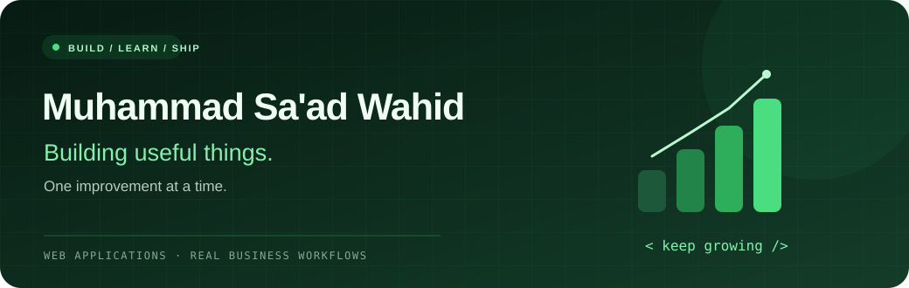
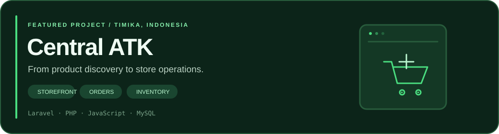

  

  
  
  

### Hi, I'm Muhammad Sa'ad Wahid 👋

I'm building practical web applications for real businesses.
My current project is **Central ATK**, a storefront and store-management application for a stationery shop in Timika, Indonesia.

**[Personal portfolio →](https://muhammad-saad-wahid.gentlepeony8.chatgpt.site)** · Also known as Sa'ad Wahid.

- 🌱 Learning by building, testing, and improving real workflows.
- 🛠️ Working with Laravel, PHP, JavaScript, and relational databases.
- 🎯 Focusing on useful features, clear interfaces, and reliable order handling.

### Tools I work with

  
  
  
  
  
  
  

### Featured project · Central ATK

A mobile-friendly shopping experience connected to the everyday work of a real store.

- **Shopping:** catalog, search, product photos, cart, and checkout.
- **Orders:** WhatsApp handoff, order tracking, and guarded cancellation.
- **Operations:** picking checklists, inventory movements, staff roles, and reports.
- **Payments:** QRIS and bank-transfer instructions, with verification by staff.
- **Assistance:** catalog-connected chatbot and customer-behavior insights.

**[Visit the website →](https://centralatk.com)**

The source repository is private. This profile shares an overview, not customer data or operational credentials.
Payment verification is handled by staff; the site does not automatically confirm bank deposits.

---

  <strong>Build thoughtfully. Test carefully. Keep improving.</strong> 
  Real projects. Real progress.

